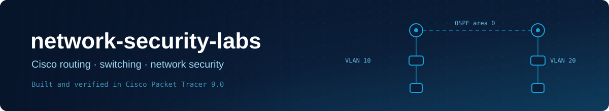
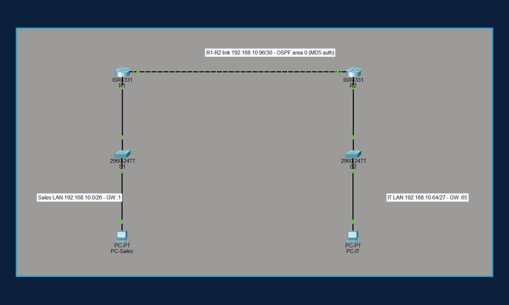
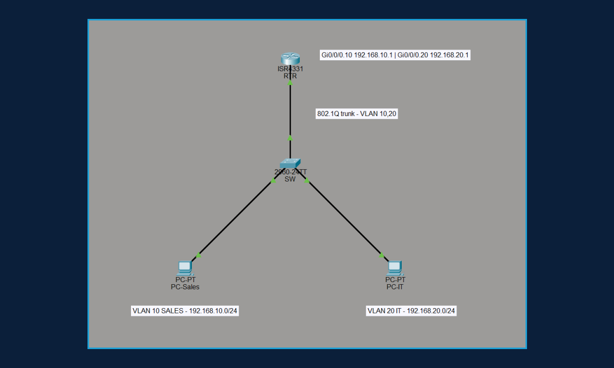

<p align="center">
  
</p>

<p align="center">
  
  
  
  
</p>

Cisco routing, switching and network security labs built in Packet Tracer. Each lab includes the topology, addressing plan, device configs, captured verification output and troubleshooting notes.

## Labs

<table>
  <tr>
    <td width="50%" valign="top">
      <a href="labs/01-two-site-ospf"></a>
      <br/>
      <b><a href="labs/01-two-site-ospf">01 - Two-site OSPF + hardening</a></b>
      <br/>
      <sub>Two sites over a point-to-point link, routed with OSPF, then hardened.</sub>
      <br/>
      <sub><code>VLSM</code> <code>OSPF area 0</code> <code>DR/BDR</code> <code>SSHv2</code> <code>VTY ACL</code> <code>login block-for</code> <code>OSPF MD5</code></sub>
    </td>
    <td width="50%" valign="top">
      <a href="labs/02-vlan-router-on-a-stick"></a>
      <br/>
      <b><a href="labs/02-vlan-router-on-a-stick">02 - VLANs + router-on-a-stick + DHCP</a></b>
      <br/>
      <sub>Two VLANs on one switch, inter-VLAN routing and DHCP on the router.</sub>
      <br/>
      <sub><code>VLANs</code> <code>802.1Q</code> <code>subinterfaces</code> <code>DHCP pools</code></sub>
    </td>
  </tr>
</table>

## Repository layout

```
labs/
  <lab>/
    README.md          overview, addressing, design notes
    configs/           device configurations (paste into the CLI)
    security/          hardening configs (where applicable)
    outputs/           show / ping output captured from the running lab
    images/            topology screenshot
    *.pkt              Packet Tracer file (where included)
tools/
  vlsm.py              VLSM subnet calculator used for the addressing plans
```

## Tools

`tools/vlsm.py` allocates subnets largest-first from a base network and prints mask, wildcard, gateway and host range for each:

```
$ python tools/vlsm.py 192.168.10.0/24 Sales=50 IT=25 R1-R2=2
| Name  | Needed | Subnet           | Mask            | Wildcard  | Usable | Gateway       | Host range                    | Broadcast     |
| Sales | 50     | 192.168.10.0/26  | 255.255.255.192 | 0.0.0.63  | 62     | 192.168.10.1  | 192.168.10.2 - 192.168.10.62  | 192.168.10.63 |
| IT    | 25     | 192.168.10.64/27 | 255.255.255.224 | 0.0.0.31  | 30     | 192.168.10.65 | 192.168.10.66 - 192.168.10.94 | 192.168.10.95 |
| R1-R2 | 2      | 192.168.10.96/30 | 255.255.255.252 | 0.0.0.3   | 2      | 192.168.10.97 | 192.168.10.98 - 192.168.10.98 | 192.168.10.99 |
```

## Environment

- Cisco Packet Tracer 9.0
- Routers: ISR4331, switches: Catalyst 2960-24TT

Passwords in the configs are lab placeholders.

## Roadmap

- [ ] Switch security: port security, DHCP snooping, DAI, BPDU guard
- [ ] Standard and extended ACLs
- [ ] NAT/PAT to an ISP
- [ ] Multi-area OSPF
- [ ] Site-to-site VPN (GRE over IPsec)
