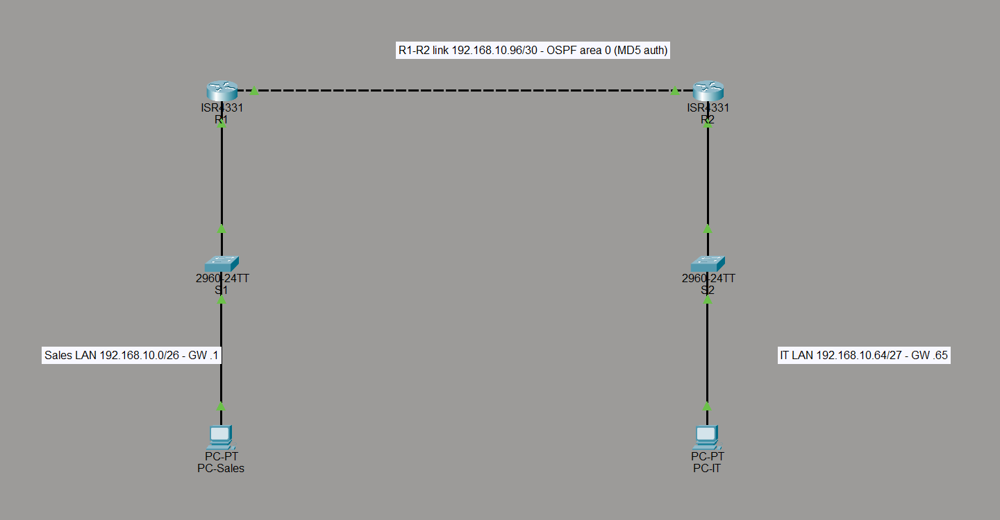

# 01 - Two-site OSPF with router hardening

Two LANs (Sales and IT) on separate routers, connected by a point-to-point link and routed with single-area OSPF. Both routers are then hardened for management access and routing-protocol security.



## Addressing

One /24 (192.168.10.0/24) divided with VLSM ([addressing-plan.md](addressing-plan.md)):

| Segment    | Subnet            | Mask            | Gateway        | Hosts |
|------------|-------------------|-----------------|----------------|-------|
| Sales LAN  | 192.168.10.0/26   | 255.255.255.192 | 192.168.10.1   | 62    |
| IT LAN     | 192.168.10.64/27  | 255.255.255.224 | 192.168.10.65  | 30    |
| R1-R2 link | 192.168.10.96/30  | 255.255.255.252 | .97 / .98      | 2     |

## Devices

| Device   | Model      | Interface    | Address            | Connected to |
|----------|------------|--------------|--------------------|--------------|
| R1       | ISR4331    | G0/0/0       | 192.168.10.1/26    | S1 G0/1      |
| R1       | ISR4331    | G0/0/1       | 192.168.10.97/30   | R2 G0/0/1    |
| R2       | ISR4331    | G0/0/0       | 192.168.10.65/27   | S2 G0/1      |
| R2       | ISR4331    | G0/0/1       | 192.168.10.98/30   | R1 G0/0/1    |
| S1, S2   | 2960-24TT  | -            | -                  | -            |
| PC-Sales | PC         | Fa0          | 192.168.10.2/26    | S1 Fa0/1     |
| PC-IT    | PC         | Fa0          | 192.168.10.66/27   | S2 Fa0/1     |

Build steps: [packet-tracer-steps.md](packet-tracer-steps.md)

## Configuration

**Base** ([R1](configs/R1.txt), [R2](configs/R2.txt)): interface addressing, OSPF process 1, area 0.

```
router ospf 1
 router-id 1.1.1.1
 network 192.168.10.0 0.0.0.63 area 0
 network 192.168.10.96 0.0.0.3 area 0
 passive-interface GigabitEthernet0/0/0
```

- Each router only advertises its directly connected networks.
- `passive-interface` is applied to the LAN side only. The R1-R2 link must stay non-passive for the adjacency to form.

**Hardening** ([R1](security/hardening-R1.txt), [R2](security/hardening-R2.txt), [report](security/hardening-report.md)), applied on top of the base config:

| Control | Commands |
|---------|----------|
| Password policy | `security passwords min-length 10`, `enable secret`, `service password-encryption` |
| Local admin account | `username admin privilege 15 secret ...` |
| SSH only | `ip domain-name`, `crypto key generate rsa general-keys modulus 2048`, `ip ssh version 2`, `transport input ssh`, `login local` |
| Management ACL | Standard ACL `MGMT-ONLY` on `line vty 0 4` (`access-class ... in`) |
| Brute-force protection | `login block-for 120 attempts 3 within 60` |
| Session timeout | `exec-timeout 5 0` on console and VTY |
| OSPF authentication | `ip ospf authentication message-digest` + `ip ospf message-digest-key 1 md5 ...` on G0/0/1 |
| Logging | `service timestamps log datetime msec`, `logging buffered 16384` |

## Verification

Full output: [outputs/verification.txt](outputs/verification.txt)

```
R1>show ip ospf neighbor
Neighbor ID     Pri   State           Dead Time   Address         Interface
2.2.2.2           1   FULL/DR         00:00:39    192.168.10.98   GigabitEthernet0/0/1

R1>show ip route ospf
O       192.168.10.64 [110/2] via 192.168.10.98, 00:02:30, GigabitEthernet0/0/1

R1>show ip ssh
SSH Enabled - version 2.0
```

- OSPF adjacency is FULL after MD5 authentication is enabled on both ends.
- PC-Sales to PC-IT: 3/4 replies on the first ping (ARP), TTL 126 (two router hops), 4/4 on repeat.

## Troubleshooting notes

- **Adjacency stuck in 2WAY.** Normal for ~40 s on a broadcast segment while the DR/BDR election runs.
- **No adjacency at all.** Check that the transit interface is not passive and that both ends use the same subnet and MD5 key. The adjacency drops while only one side has authentication configured.
- **Packet Tracer IOS differences** found while testing:
  - `transport input ssh telnet` is rejected; PT accepts a single option (`ssh`, `telnet`, `all`).
  - `log` is not accepted on standard ACL entries (`deny any log`).
  - `logging buffered` takes a size but not a severity level.
- **SSH lockout.** Create the domain name, RSA keys and local user before setting `transport input ssh` and `login local` on the VTY lines.

## Files

```
configs/R1.txt, R2.txt              base configuration
security/hardening-R1.txt, R2.txt   hardening configuration
security/hardening-report.md        control-by-control explanation
outputs/verification.txt            captured show / ping output
addressing-plan.md / .csv           VLSM table (generated with tools/vlsm.py)
verify.md                           verification checklist
two-site-ospf.pkt                   Packet Tracer file
```
