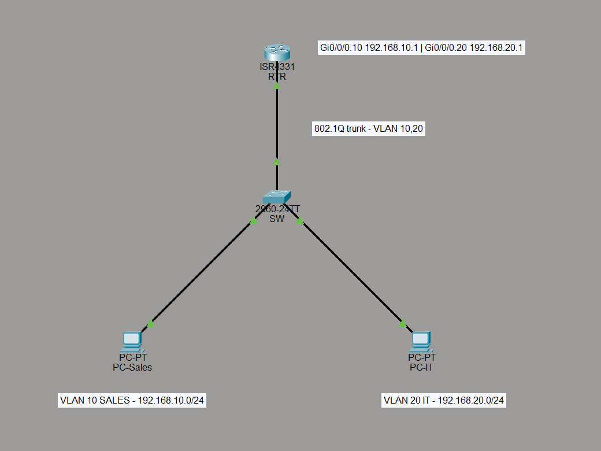

# 02 - VLANs, router-on-a-stick and DHCP

Two departments separated into VLANs on a single access switch. One router performs inter-VLAN routing over an 802.1Q trunk and serves DHCP for both VLANs.



## Addressing

| VLAN | Name  | Subnet          | Gateway                    | DHCP pool             |
|------|-------|-----------------|----------------------------|-----------------------|
| 10   | SALES | 192.168.10.0/24 | 192.168.10.1 (G0/0/0.10)   | .10 - .254            |
| 20   | IT    | 192.168.20.0/24 | 192.168.20.1 (G0/0/0.20)   | .10 - .254            |

`.1` to `.9` are excluded from DHCP and reserved for infrastructure.

## Devices

| Device   | Model     | Port   | Mode / Address          | Connected to |
|----------|-----------|--------|-------------------------|--------------|
| RTR      | ISR4331   | G0/0/0 | Trunk parent, no IP     | SW G0/1      |
| SW       | 2960-24TT | G0/1   | Trunk, allowed 10,20    | RTR G0/0/0   |
| SW       | 2960-24TT | Fa0/1  | Access VLAN 10          | PC-Sales     |
| SW       | 2960-24TT | Fa0/2  | Access VLAN 20          | PC-IT        |
| PC-Sales | PC        | Fa0    | DHCP                    | SW Fa0/1     |
| PC-IT    | PC        | Fa0    | DHCP                    | SW Fa0/2     |

## Configuration

[configs/SW.txt](configs/SW.txt), [configs/RTR.txt](configs/RTR.txt)

Switch trunk:

```
interface GigabitEthernet0/1
 switchport mode trunk
 switchport trunk allowed vlan 10,20
```

Router subinterfaces and DHCP:

```
interface GigabitEthernet0/0/0
 no shutdown
interface GigabitEthernet0/0/0.10
 encapsulation dot1Q 10
 ip address 192.168.10.1 255.255.255.0
interface GigabitEthernet0/0/0.20
 encapsulation dot1Q 20
 ip address 192.168.20.1 255.255.255.0
!
ip dhcp excluded-address 192.168.10.1 192.168.10.9
ip dhcp pool SALES
 network 192.168.10.0 255.255.255.0
 default-router 192.168.10.1
```

## Verification

Full output: [outputs/verification.txt](outputs/verification.txt)

```
SW#show interfaces trunk
Port        Mode         Encapsulation  Status        Native vlan
Gig0/1      on           802.1q         trunking      1

RTR#show ip dhcp binding
IP address       Client-ID/              Lease expiration        Type
192.168.10.11    00D0.D3EA.E16C           --                     Automatic
192.168.20.11    00E0.F9A8.9EE9           --                     Automatic
```

- Both subinterfaces up/up; each PC leases an address from its own VLAN's pool.
- PC-Sales (VLAN 10) to PC-IT (VLAN 20): TTL 127, one routed hop through RTR.

## Notes

- The parent interface carries no IP address but must be `no shutdown`; the subinterfaces inherit its state.
- `encapsulation dot1Q` IDs must match the VLAN IDs on the switch, or tagged frames are dropped.
- The trunk is limited to the VLANs in use instead of allowing all VLANs.

## Possible improvements

- Move the native VLAN off VLAN 1 and park unused ports in a shutdown VLAN.
- Add port security and DHCP snooping on access ports.
- Compare with a Layer 3 switch design (SVIs and `ip routing`).
